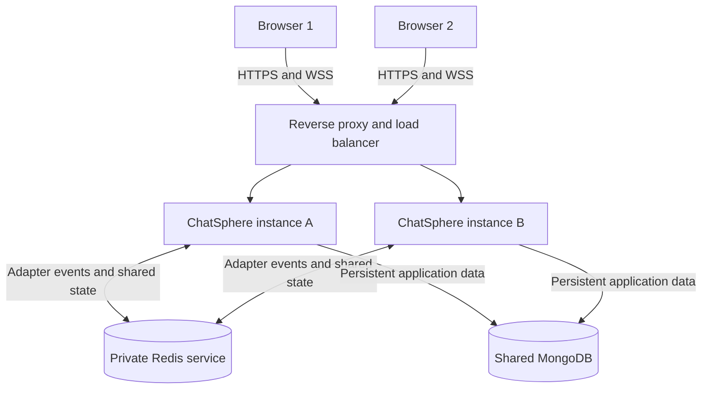

# TC-028: horizontal-scaling architecture addendum

**Requirement:** NFR-14. **Review type:** non-blocking architecture inspection.
**Date:** 12 November 2026. **Baseline inspected:** `fb81f2b`.
**Document status:** proposed design, ready for team review; not a deployment report.

## Review objective and conclusion

The official test plan in `Deliverable1/ChatSphere_Software_Test_Plan.docx`
asks whether the architecture permits multiple application instances and
identifies a shared mechanism for state/events. Its expected result is a
documented, feasible scaling path that avoids dependence on instance-local state
for cross-instance message delivery. It does not require an executed multi-node
load test to pass the **design inspection**.

**Conclusion:** the current implementation is a single-instance application.
This addendum documents a proposed two-instance design and the changes needed
to remove its identified scaling barriers. It addresses the missing design path
for review; it does not make the existing implementation horizontally scalable.
The team must review and accept the design before recording TC-028 as PASS
(design inspection only). Until then, keep the review pending/non-blocking gap.
Never change the runtime result to PASS or describe the proposal as implemented.

## Findings in the current implementation

| Evidence at the inspected baseline | Consequence across separate processes |
| --- | --- |
| `server/src/socket/index.js` creates Socket.IO without a shared adapter | An event emitted by A does not reach sockets held only by B |
| `server/src/utils/presence.js` uses a Map and `socket/presence.js` exports one process-local tracker | A cannot reliably determine whether a user is connected to B |
| `server/src/utils/rateLimiter.js` keeps windows in memory | A user's/IP's traffic can consume a separate allowance on each node |
| `server/src/socket/index.js` checks local presence when choosing message status | A receiver on B can be misclassified as offline by A |
| `server/src/controllers/roomController.js` synchronizes live socket rooms through the current adapter | Membership updates need cluster-wide propagation and completion handling |

MongoDB stores users, rooms, read state and messages. Persistence alone does not
route socket broadcasts or synchronize the above process-local trackers.
A successful 50-user test against one server is evidence for TC-027, not proof
of cross-instance operation for TC-028.

## Proposed two-instance deployment

Both instances run the same application build and use the same MongoDB database,
JWT verification settings and environment-specific Redis namespace. Each process
owns its physical sockets; shared services supply cluster-wide state. Local
connection objects may remain local, but cannot be the only authority for global
presence, delivery routing or rate-limit decisions.

### Cross-instance events and connection recovery

Configure `@socket.io/redis-streams-adapter` with a connected Redis client on
**every** instance before accepting connections. Reuse the existing `user:<id>`
and `room:<id>` room names. A message accepted on A is saved to MongoDB, then
emitted through the adapter so eligible clients on A and B can receive it.
Typing, status and room-update events use the same shared adapter.

Redis Streams is selected because Socket.IO documents support for cross-server
events and connection-state recovery. The classic Pub/Sub adapter must not be
treated as interchangeable when assuming recovery support. This is an adapter
choice, not a replacement for the application's shared presence/rate-limit work.

For the first cluster deployment, disable automatic Socket.IO session replay
and use the client's existing reconnection/history resynchronization. Recheck
JWTs and reload authorized MongoDB room memberships on every connection. This
avoids blindly restoring a room that a user left while disconnected. Enable
bounded replay later only after tests prove membership revocation cannot expose
cached room messages. Automatic reconnection remains required in either mode.

### Presence and message status

Replace the global authority of the local Map with Redis-backed presence:

- Track socket counts by user **and process**, plus a global per-user count.
  Use atomic operations for connect/disconnect transitions. Online means the
  global count is greater than zero, including tabs connected to different nodes.
- Give each process a heartbeat lease, proposed every 5 seconds with a 15-second
  expiry. A cleanup worker atomically removes an expired process's contributions
  once; graceful disconnect and crash cleanup must not subtract a socket twice.
- Broadcast only global offline/online transitions. Include a monotonic per-user
  revision so clients can discard stale updates; request a fresh snapshot after
  reconnecting. Abrupt-crash detection is bounded by the lease and cleanup interval,
  rather than being instantaneous.
- Read shared presence for initial `sent`/`delivered` decisions and online-user
  health counts. Retain the current meaning of status; presence alone is not a
  new acknowledgement that every client has processed a message.

These calls become asynchronous. Update `socket/presence.js`, message handling
in `socket/index.js`, and health reporting together. The local tracker may remain
as a cache, but a local miss must not mean the user is offline globally.
Socket.IO's official connected-user guide describes shared counts and per-process
crash cleanup; see references below.

### Shared limits

Keep the existing limits but store counters in Redis. Key them by environment,
limit type and user ID (messages) or trusted client IP (API/auth requests).
Increment and set/reset expiry in one atomic operation, using Redis time for
window boundaries and Retry-After. Do not grant a new allowance when a request
lands on B instead of A. Apply the same principle to typing limits.

Restrict Express proxy trust to the deployed reverse proxy; arbitrary forwarded
IP headers must not choose the rate-limit key. Preserve independent API/auth
allowances and the current rejection responses.

### Shared persistence and authorization

MongoDB remains authoritative for membership, message content, message IDs and
read state. Retain the existing indexes and pool configuration on each node;
the combined pool size must fit the database connection budget.

Join/leave operations must update sockets on **all** live nodes. Wait for explicit
per-node acknowledgements of applying the membership change (for example, an
inter-server request/ack handler), rather than assuming a fire-and-forget call
has completed everywhere. On timeout return a retryable synchronization error;
the database update is idempotent and remains authoritative. Revalidate membership
on reconnect. Do not report a successful leave while another node knowingly
retains the user's subscription.

Multiple tabs may concurrently flush pending messages. Preserve at-least-once
delivery with message-ID deduplication; use a per-user lease if serializing the
flush. Status updates must be conditional/monotonic so a concurrent delivery
update cannot downgrade a message already marked read. Exactly-once delivery is
not claimed. Messages saved during an interrupted broadcast are recovered from
MongoDB history, not inferred solely from broker state.

## Load balancing, failures and operations

The reverse proxy must support WebSocket upgrades and suitable idle timeouts.
Because the existing client allows polling fallback, configure session affinity
for Engine.IO polling requests. An adapter does not remove this requirement.
A deliberately WebSocket-only deployment is an alternative, with loss of that
fallback documented and tested.

Introduce separate readiness and liveness checks. Distributed mode is ready only
after MongoDB, Redis, adapter initialization and presence registration succeed.
On Redis loss, stop accepting new distributed operations and return retryable
errors; do not silently fall back to local broadcasts or reset global limits.
Signal affected clients to reconnect/resynchronize and keep saved messages in
MongoDB. An in-flight database write and broadcast are not one atomic transaction;
history recovery and ID deduplication are required after disruption.

On shutdown, drain connections, remove the process's presence contribution,
close adapter/Redis clients and close MongoDB. Leases cover an ungraceful crash.
Keep Redis private with appropriate authentication, ACLs and transport protection.
Do not expose Redis credentials to browsers or store them in the repository.
Redis/MongoDB availability and capacity remain deployment dependencies; two app
instances alone do not eliminate shared-service failure points.

## Implementation sequence and validation gates

| Stage | Proposed work | Required check before enabling distributed mode |
| --- | --- | --- |
| 1 | Shared adapter and reverse proxy | Place sender on A and recipient on B; confirm private/group/typing/status events cross nodes |
| 2 | Redis presence and async call sites | User has one tab on each node; closing one stays online; killing A expires only A's contributions |
| 3 | Atomic shared limits | Alternate traffic across A/B and confirm one combined allowance, including concurrent requests |
| 4 | Membership and reconnect synchronization | Create/join/leave through A while sockets are on B; left members receive no subsequent room traffic |
| 5 | Outage and recovery handling | Interrupt Redis, stop a node, restart it; verify readiness/error behavior, bounded stale presence, history recovery and no status downgrade |
| 6 | Cluster performance validation | Run at least 50 users distributed across two actual processes; record node placement, unique deliveries and latency |

For stages 1–6, force or record node placement: all clients accidentally landing
on A is not cross-node evidence. Exercise both polling fallback with affinity and
the production WebSocket route. Store real command outputs, configuration/build
identifiers and observed outcomes; do not mark these planned checks executed.

## TC-028 review record

| Review question | Design evidence in this addendum |
| --- | --- |
| Are at least two application instances shown? | Two-instance deployment diagram |
| Is cross-instance event forwarding specified? | Redis Streams adapter and existing user/room destinations |
| Are process-local authority barriers addressed? | Shared presence with crash cleanup; shared atomic limit windows |
| Are persistence, membership and delivery effects covered? | MongoDB authority, membership acknowledgements and monotonic status rules |
| Are deployment and verification requirements explicit? | Affinity/readiness/failure handling and staged two-node checks |

**Prepared inspection finding:** a feasible scaling path is now specified for
team review without changing the application's client/server/database layering.
Implementation and distributed-system validation remain future work.
**Reviewer and acceptance date:** pending. **Runtime multi-instance test:** not executed.

Suggested execution-register entry **after reviewer acceptance**:

> TC-028 — PASS (architecture inspection only). The horizontal-scaling addendum
> documents two application instances, shared Socket.IO forwarding, shared
> presence/rate limits, failure handling and a staged verification plan. Current
> deployed-code inspection still identifies a single-instance implementation;
> multi-instance runtime behavior has not been validated.

If the design is not accepted, retain the non-blocking gap and record the reviewer's
specific unresolved findings. The test register must distinguish design acceptance
from implementation or load-test evidence.

## References

- Project SRS NFR-14 and STP TC-028 in `Deliverable1/` (review criteria).
- [Socket.IO: multiple nodes](https://socket.io/docs/v4/using-multiple-nodes/)
  (load balancing, polling affinity and event forwarding).
- [Socket.IO: Redis Streams adapter](https://socket.io/docs/v4/redis-streams-adapter/)
  (adapter selection, supported features and private Redis infrastructure).
- [Socket.IO: connected users](https://socket.io/how-to/count-connected-users)
  (shared presence counts and cleanup after process failure).

External references were checked on 12 November 2026. All deployment/state choices
above are proposed ChatSphere design decisions, not evidence of an implemented
Redis integration.
